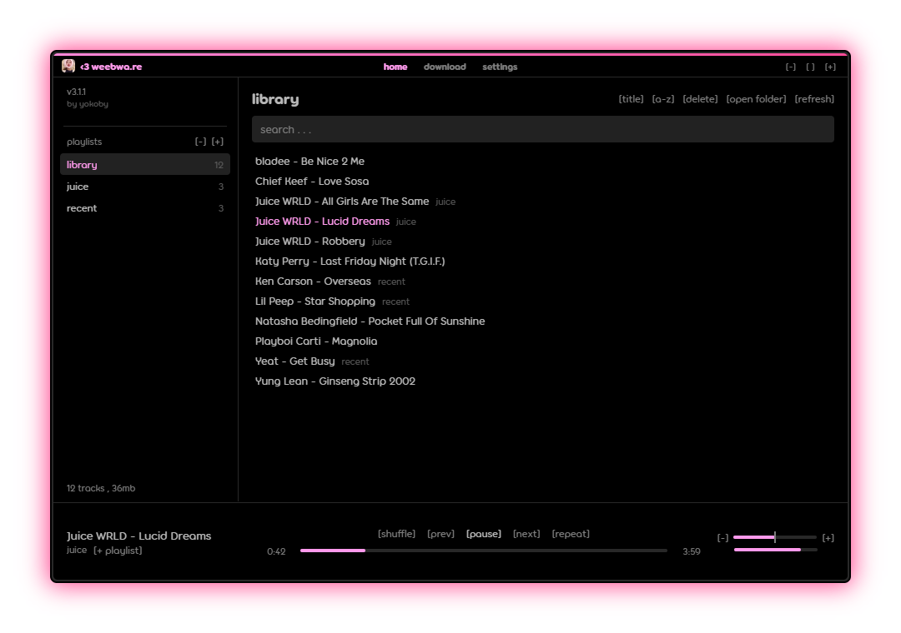

## Languages


( JavaScript , Electron 44 )

## weebware


music player for the folder you already have. subfolders are playlists , drag songs onto one to move them in. tags get read once and cached , so a 900 song library opens instantly

* soundcloud downloads , search or paste a track , playlist or profile link. go+ previews and drm songs get skipped instead of saved broken
* discord rich presence , media keys , the windows media flyout , mac now playing
* waveform , visualizer , bass boost , reverb , playback speed
* your own colors , accent , gradient , background
* file names get tidied as songs show up , a stray _ , (official audio) , a copy's (1)
* no account , no tracking. the only things going out are soundcloud searches and discord

## Running it
needs node.js

```
npm install
npm start
```

`npm run pack` builds `build/weebware-win32-x64/weebware.exe` , `npm run pack:mac` on a mac

songs go in `Music/weebware` , settings live in `%APPDATA%/weebware-electron`

torus isn't included , it's a paid font. drop `Torus-Regular.otf` and `Torus-Bold.otf` in `assets/fonts` if you have it , otherwise it uses your system font

## Authors
* yokoby , weebware
* pep
